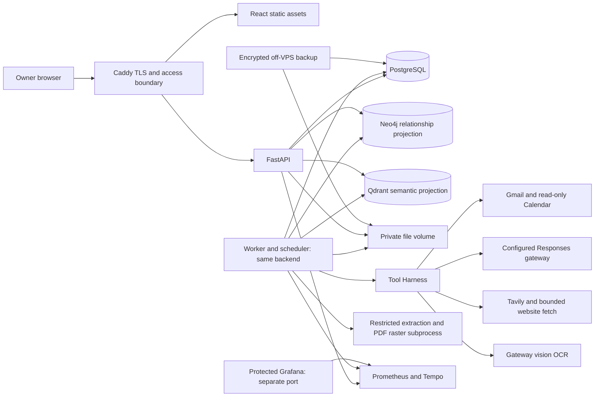

# Codebase blueprint

Status: Architecture accepted by the owner on October 20, 2026. Tracks [issue #10](https://github.com/mr-bean-and-agents-squad/email-assistant/issues/10). Implementation and private setup verification remain pending.

## Contract

Outcome: define an implementable architecture, folder ownership, seven role contracts, persistence and recovery rules, provider boundaries, evaluation and VPS operations for the complete [product brief](product-brief.md).

Constraints: one owner, one Gmail account, read-only Calendar, one application with explicit orchestration, independent exact-content approvals, all brief capabilities retained. Python backend, React frontend, Neo4j and Qdrant are owner-selected.

Non-goals: application scaffolding, feature implementation, deployment, real email processing or sending, and acceptance of dependent issues.

Acceptance: owner accepts this blueprint; provider capability evidence resolves required integration choices; every brief requirement and dependent issue has an owning boundary and verification route. A draft document alone does not complete #10.

## Architecture decisions

| Area | Direction | Status |
| --- | --- | --- |
| Backend and UI | Python and React | Owner-selected |
| Framework and transactional storage | FastAPI, Pydantic, Vite, PostgreSQL, SQLAlchemy/Alembic | Accepted architecture |
| Graph and semantic retrieval | Neo4j and Qdrant | Owner-selected; integration contracts accepted below |
| Search | Tavily, using the free allowance without paid fallback | Owner-selected; account integration pending |
| OCR | Configured vision model through the LLM provider adapter | Owner-selected direction; document-quality evaluation required |
| Embeddings | Free OpenRouter embedding route | Owner-selected direction; model quality, dimensions and account limits require verification |

Runtime endpoint/model selections and credentials belong in private configuration, not this blueprint. Host specifications and live probe history are not application settings and are omitted. The [configuration template](../.env.example) defines the current setup keys; private values live in the Git-ignored, owner-readable local `.env`. Application configuration loading is not implemented yet. Text and OCR share the configured model; no separate vision-model setting is required.

## Options and trade-offs

| Option | Main assumption | First failure condition |
| --- | --- | --- |
| Python backend, React UI, PostgreSQL, worker from same codebase | Python document tooling and explicit workflows fit the workload | Local raster/export and telemetry exceed VPS resources or worker latency expectations |
| TypeScript full stack | One-language maintenance outweighs Python document tooling | Required extraction/OCR needs a separate runtime, weakening the one-language benefit |

Recommended: the Python direction selected by the owner. Better approaches: none; this preserves the accepted single-application architecture and owner stack preference. Separate agent services are unnecessary for the accepted bounded workflows.

## Topology



API and worker are two processes of one application, not independent agent services. PostgreSQL owns durable jobs; request background tasks and in-memory timers are not the source of truth. Start one worker with bounded concurrency, initially one raster/export job at a time. Neo4j and Qdrant are required product stores with the query responsibilities below. Redis is not required by this design.

Serve UI and API under one origin. Only the TLS ingress is public. PostgreSQL, Neo4j, Qdrant and telemetry backends stay on the internal Compose network. Grafana uses a distinct localhost-bound host port, accessed through an SSH tunnel with Grafana authentication. A public Grafana hostname would require a separately approved protected route.

## Concrete folder ownership

```text
apps/
  backend/
    pyproject.toml
    src/email_assistant/
      api/              # HTTP, owner session, request validation
      domain/           # Versioned business entities and invariants
      agents/           # Seven role contracts and role execution
      workflows/        # Email/meeting steps and durable transitions
      tools/            # Harness and capability allowlists
      providers/        # Google, gateway, search and extraction adapters
      persistence/      # PostgreSQL records/outbox, Neo4j/Qdrant projections
      retrieval/        # Graph/vector queries and canonical result validation
      worker/           # Scheduler, leases, retries and retention jobs
      reports/          # Shared report model and three renderers
      observability/    # Redacted logs, metrics and trace wiring
    migrations/         # Alembic; one ordered migration history
    tests/              # Unit, database integration and API tests
    evals/
      cases/            # Permitted synthetic/redacted six-scenario inputs
      checks/           # Grounding, quality and scenario acceptance checks
  web/
    src/                # React review UI, settings and typed API client
    tests/              # Browser flows, UI behavior and accessibility checks
deploy/
  compose.yaml
  Caddyfile
  observability/
scripts/
  backup.sh
  restore.sh
docs/
plans/
```

The owner authorized creation of this directory structure with `.gitkeep` files for empty directories. Listed application manifests, configuration and scripts remain implementation contracts; do not create empty or nonfunctional versions of those files. API is the public contract, represented by OpenAPI and a generated TypeScript client. Frontend does not access DB, provider credentials or tool execution directly. No agent can bypass the harness through a separate provider client.

`apps/backend` owns both API and worker; `apps/web` owns the browser application. Agent evaluations live in `apps/backend/evals` because they exercise backend workflows and use their provider adapters and domain contracts. Keep deterministic correctness and recovery tests in `apps/backend/tests`, and browser acceptance flows in `apps/web/tests`; evaluation cases own the six presentation scenarios and report/reply quality. The shared `apps/` parent groups application code without requiring a common build system or new workspace tooling.

## Seven role contracts

Every execution carries run ID, role ID, input revision, allowed tools, deadline and budget reservation. Outputs use validated schemas; model output is untrusted.

| Role | Input | Output | Allowed tools and side effects |
| --- | --- | --- | --- |
| Email | Selected Gmail thread and owner guidance | Eligibility, normalized thread, reply draft, missing information | Read Gmail and attachment metadata; no sending |
| Web Research | Resolved company, explicit research questions | Claims with source URLs, timestamps and conflicts | Bounded search and public HTTP fetch; no mailbox or publishing |
| Company Info | Company identifiers and owner decisions | Match candidates or resolved profile | Read company DB and Neo4j relationship candidates; uncertain identity requires owner resolution |
| Calendar | Calendar cursor/window and resolved companies | Meeting context and preparation candidates | Calendar read and Neo4j context lookup; no event mutation |
| Report Generation | Research, extraction and meeting context | Internal report model, Markdown/PDF/DOCX artifacts | Render artifacts; no send or KB publication |
| Memory | Resolved company and source/report revisions | Reusable research with provenance and approval status | Read history and Qdrant candidates; write draft history; publish only through approved action executor |
| Human Approval | Immutable action revision and authenticated owner decision | Approval/rejection bound to content, recipients and attachments | Validate owner decision; issue executable authorization; model cannot approve |

An application action executor performs approved reply sends, report forwarding and KB publication. These are separate action kinds and approvals. Internal reports never enter reply text implicitly.

## Graph and semantic retrieval

PostgreSQL remains the authoritative store for business records, relationship facts, provenance, versions, approvals, actions, jobs and budgets. Neo4j and Qdrant are rebuildable projections with real query responsibilities, not independent authorities for approval or dispatch.

| Store | Product responsibility | Example |
| --- | --- | --- |
| PostgreSQL | Transactional records and current validity | Is this report revision approved and still retained? |
| Neo4j | Traverse relationships among companies, contacts, meetings, reports and sources | Which prior meetings and sourced reports relate to this company and these contacts? |
| Qdrant | Retrieve semantically relevant research/report chunks | Which prior findings discuss a similar business need despite different wording? |

Company Info and Calendar query Neo4j for related context; Memory retrieves Qdrant candidates for Report Generation and reply drafting. Both return canonical IDs and source revisions. Check current authorization, revision, deletion state and allowed knowledge status in PostgreSQL before any retrieved content reaches a prompt or UI. Draft research may be reused only in workflows that permit it and must remain labeled unapproved. Model-inferred relationships carry evidence and confirmation status; they are not silently promoted to verified facts.

Persist a canonical mutation and projection outbox event in one PostgreSQL transaction. The existing worker applies each event to Neo4j and Qdrant with separate checkpoints, stable IDs, idempotent writes, revision ordering and deletion tombstones. No distributed transaction across three databases is promised. Report projection lag or outage explicitly; an unavailable or incomplete index must not imply that no company/history exists. Affected semantic/relationship steps remain pending or explicitly degraded; approval and send safety remain PostgreSQL-owned.

Store graph relationship facts and source provenance canonically so rebuilding Neo4j requires no new LLM inference. For Qdrant, preserve chunk text, source revision, embedding model/version, dimensions and generated vectors in the private backed-up artifact store with PostgreSQL metadata. This avoids mandatory paid re-embedding after restore; owner deletion must remove the cached vectors too. Rebuild into a new collection when the embedding model/dimension changes, verify coverage, then switch reads; never mix incompatible vectors. Use the owner-selected free OpenRouter embedding route. Select the model in private configuration after Vietnamese/English retrieval checks, output dimension verification, provider data-handling review and account quota checks. Do not silently fall back to paid models; quota exhaustion leaves indexing pending with bounded retries. Verify current pricing during setup; unknown cost remains unmeasured.

Keep both services private with authentication and independent durable volumes. Tune Neo4j heap/page cache and Qdrant memory/disk indexing only against the chosen versions and representative data. The configured deployment needs a full-stack capacity test including PostgreSQL, graph, vectors, worker and telemetry. If it cannot meet the measured workload, present capacity or hosting choices; do not silently remove either selected database.

## State, ownership and recovery

PostgreSQL owns owner settings, OAuth token ciphertext, companies, thread/event cursors, source provenance, draft/report versions, approvals, action attempts, jobs, budget reservations and audit history. Private filesystem volumes own downloaded attachments and generated artifacts, addressed through DB metadata and hashes. Do not expose filesystem paths as authorization.

Run state: queued, running, awaiting_owner, succeeded, partial, failed or canceled. Persist each completed step and its input revisions. Restart resumes eligible unfinished work, not an entire run blindly. Company ambiguity pauses dependent research/drafting until owner resolution.

Action state: draft, awaiting_approval, approved, claimed, succeeded, failed_known or unknown. Approval binds action kind, content hash/version, exact destination list and attachment hashes. Editing creates a new revision and invalidates the old authorization. Claim and approval validity checks happen transactionally immediately before dispatch.

Use unique logical action keys and transactional claims with leases. Keep claim transactions short; long-running work renews leases with heartbeats and uses fencing/version checks so a stale worker cannot commit results or dispatch new actions. Expired leases may reclaim safe read/research work. A claimed external send whose process dies becomes unknown until reconciled; lease expiry does not prove failure. Reconcile using stored provider identifiers and stable message metadata. Absence in a search is not proof of non-delivery. If reconciliation cannot establish the outcome, retain unknown and require explicit owner resolution; never blindly resend. Do not promise provider-level exactly-once delivery.

KB publication is a transaction with a unique approved revision key. Draft research remains distinguishable from approved knowledge. Preserve profiles, approved reports and approval history until owner deletion. Default 30-day cleanup applies to downloads/intermediates and operational logs, with configurable settings; retained approved-report artifacts must not be swept as temporary exports. Deletion stays local and never changes Gmail or Calendar.

Scheduler persists cursors, next due time, job uniqueness keys and event revisions. Default email schedule is 08:00 Asia/Bangkok; meeting preparation is 24 hours before start. Propose a configurable five-minute Calendar poll and one catch-up scan after downtime. Late meetings enter the next poll. Reschedule/cancel invalidates obsolete pending preparation. Manual and scheduled work share deduplication keys. Automation remains disabled until connections and enforceable budgets are valid.

## Provider and security boundaries

Gateway adapter uses the configured Responses protocol rather than assuming Chat Completions. Required probes cover text, function-call shape, validated structured output, returned usage, timeouts and rate limits. Vision is required for the owner-selected gateway OCR route. Handle unsupported capabilities explicitly. Bound retry count and reserve budget for every actual attempt; never automatically replay ambiguous external mutations.

Tavily is the selected search provider for public company research and recent news. Prefer basic search within the free allowance; extraction and deeper search consume additional credits. Keep paid usage disabled and pause research when quota is exhausted. Confirm account quota, rate limits, result-retention terms and required search capabilities during setup using the provider documentation; public plan descriptions are not proof of account entitlement.

Query company names and public research questions only; exclude raw email bodies, private attachments and owner profile data. Retrieve pages with request deadlines, redirect revalidation, response size limits and SSRF protections covering resolved addresses. Search results and pages cannot grant tool permissions. Separately retrieved publisher content remains subject to its own access and usage terms.

Extract PDF text with pypdf and DOCX text with python-docx. Extract supported embedded DOCX images for gateway OCR while preserving their document location; explicitly flag images or embedded objects that cannot be read rather than declaring complete extraction. For scans and PNG/JPEG, use the gateway vision model selected by the owner; rasterize PDF pages with a library such as pypdfium2 before sending bounded batches. Do not add local Tesseract as a default or silent fallback. Verify parser licenses and packaging before locking dependencies. Enforce the accepted 20 MB per-file limit plus page, pixel, decompression, CPU/time and memory limits. Rasterization and parsing run in restricted subprocesses without network access. MIME/content mismatch, encrypted, unreadable, oversized and unsupported files produce explicit outcomes.

Vision OCR sends document images to the configured gateway; treat it as a billable provider operation with the same budget, privacy and tool controls. Validate image support for the exact selected model, request format and gateway route. A model name or successful text call does not prove image support. Persist extracted text with page/source references; flag uncertain or illegible text and prohibit invented content. Preserve visual evidence for owner review. Real English/Vietnamese scans, tables and difficult layouts need quality evaluation beyond a synthetic smoke test. Gateway image-size limits, retention policy and cost rules remain setup/discovery evidence requirements.

Generate all exports from one structured report model. Markdown, WeasyPrint PDF and python-docx DOCX preserve citations. Disable arbitrary network/local-file loading in PDF rendering; only application-owned assets may load. Test Unicode fonts, links and page layout in actual consumers.

Owner login uses Google OIDC with verified issuer/audience, state/nonce and a configured immutable owner subject allowlist; secure HttpOnly same-site sessions and CSRF protection. Gmail/Calendar authorization is a separate connector consent. Request gmail.readonly plus gmail.send and calendar.readonly, without event-write scope. Confirm Google OAuth publication/verification and refresh-token restrictions for the actual account before relying on unattended operation.

Keep application credentials in permission-restricted host files mounted read-only; keep them out of images, Git and frontend bundles. Encrypt refresh tokens in DB with a key outside DB. Recovery needs that key, so back it up separately with restricted access. Email, attachments and web pages are untrusted data. Enforce all six harness stages: schema validation, authentication, scope/capability check, rate/budget check, audit record and execution.

## Budgets and observability

Atomically reserve per-run and daily allowance before a billable attempt; concurrent jobs cannot spend the same balance. Record measured usage when returned. Unknown usage or price is unmeasured, never zero; unresolved reservations remain conservatively accounted for. Monetary caps are enforceable only with trusted pricing and bounded chargeable usage or a provider hard cap. Otherwise automation requires an explicit owner-configured enforceable fallback, as accepted in #24, and must not advertise a guaranteed monetary ceiling. Call limits cap attempts only; token limits require verified provider output-limit enforcement and bounded inputs. Disable automation when neither the selected monetary policy nor the selected fallback can be enforced. Owner budget amounts remain setup inputs.

Expose a seven-role inventory, run/tool success and failure counts, latency, measured usage/cost and unmeasured status. Use OpenTelemetry spans to Tempo, metrics to Prometheus and Grafana dashboards on its separate protected port. Operational logs, trace attributes/events and metric labels exclude email bodies, prompts, tokens and private attachment content. Audit stores identifiers, revisions, decision metadata and outcomes, with protected access. Apply configured log retention and bounded trace/metric storage; measure actual memory before selecting retention sizes.

## Deployment and recovery route

Compose services: ingress/static UI, API, worker, PostgreSQL, Neo4j, Qdrant, Prometheus, Tempo and Grafana. Pin tested versions during implementation. Run parsers without privileges, use resource limits and persistent DB/files volumes. Confirm Docker support and image compatibility on the configured host. Measure the full stack with PDF rasterization and export before accepting deployment capacity.

Owner-selected backup route: restic to Cloudflare R2, encrypted with a separately retained recovery password. Run daily; retain seven daily and four weekly snapshots. The accepted recovery-point target is at most 24 hours of data loss; recovery time must be measured in a restore drill. Measure the age of the latest snapshot successfully uploaded off-VPS; a daily start time alone cannot guarantee this target because uploads and retries take time. Reserve scheduling/retry headroom and alert before the completed-snapshot age exceeds 24 hours. This remains a target until operation and restore drills demonstrate it. A host job quiesces application writes and worker jobs, takes pg_dump and copies matching file metadata/artifacts, including cached embeddings, into staging, resumes the app, then uploads encrypted backup. Restrict staging permissions to the backup operator; clean staging on success or failure and ensure failure handling resumes the application. Do not back up a live PostgreSQL data directory as ordinary files. Restore into an isolated instance and verify migration revision, record/artifact references, token decryption and owner access with all sending/scheduling disabled. Rebuild Neo4j and Qdrant from the restored canonical records and cached vectors, then verify query results, revisions and deletion filtering before re-enabling retrieval. Their runtime volumes are not independently authoritative backups. R2 bucket/account configuration, access policy and the recovery-time measurement remain setup inputs.

Proposed command contracts for subsequent implementation (not runnable today):

- `scripts/backup.sh --config <private-config> --staging <private-staging-directory>` performs the consistent snapshot/upload. The restricted configuration supplies the restic repository, recovery-password retrieval source, R2 credential source, source PostgreSQL connection, artifact roots and deployment-specific quiesce/resume operations. Refuse an unsafe or shared staging destination. Success requires a completed off-VPS snapshot identifier and timestamp; a local dump alone is not success.
- `scripts/restore.sh --config <private-config> --snapshot <snapshot-id> --target <isolated-target>` restores an explicitly selected snapshot. The restricted configuration resolves the target database and artifact locations plus the separate token-decryption key source. Refuse a live or nonempty target and keep sending and scheduling disabled. Success requires the consistency, decryption, access and projection checks described above.

Both commands must return nonzero for incomplete work, identify the failed operation without printing secrets, and distinguish backup/resume, upload, restore and validation failures. Backup failure handling must attempt to resume the application and report a resume failure explicitly. Deployment work owns the scripts, concrete private configuration, exact exit-code mapping and operator validation. Acceptance here selects the interface and recovery policy; it does not claim an executable route or a successful restore.

## Verification and downstream ownership

| Requirement | Owning work | Required evidence |
| --- | --- | --- |
| Skeleton, storage, owner access/profile | #11-14 | Start/build checks, migrations, owner-denial and persistence tests |
| Gmail/Calendar, ingestion/company lookup | #15-17, #21, #26 | Scoped consent, cursor recovery, deduplication and uncertain matches |
| Memory, approval and uncertain actions | #18-20, #33, #35 | Revision invalidation, concurrent claims, crash-before/after-send and reconciliation |
| Gateway, harness, budgets, retention | #22-25, #31 | Live redacted probe, six-stage checks, injection and missing-usage/concurrency cases |
| Research, attachments, reports/exports | #27-30, #32 | Traceable claims, hostile/large files, no invented terms, readable cited exports |
| Review UI and manual/scheduled flows | #34, #36-37 | Separate approvals, seven observable roles, controlled-clock recovery cases |
| Telemetry and Grafana | #38-39 | Redacted spans, failures, cost uncertainty and protected separate-port access |
| Evaluation/deployment/live demo | #40-44 | All six source scenarios, owner usefulness/tone review, protected live run and ten-minute presentation |

Use pytest for domain/provider and PostgreSQL integration checks, plus actual Neo4j/Qdrant query tests, reordered/duplicate projection events, deletion/revision filtering, store outage and projection rebuild checks; Playwright for real browser flows, access boundaries and review accessibility. Deterministic tests use permitted controlled inputs; live integration evidence is separate. Never treat presentation sample numbers as thresholds. The six original scenarios must be transcribed from the permitted source presentation when building the evaluation suite, not invented from a summary.

Dependent issue refinements: #11-12 own the Neo4j/Qdrant services, canonical outbox and projection storage; #17/#21 own graph queries; #18/#33 own semantic retrieval, embedding cache and knowledge-status filtering; #25 owns cross-store deletion; #38-39 own projection health/lag metrics; #40-42 own integration, failure/rebuild checks and capacity/backup validation. These refinements are recorded here, not yet posted to GitHub. #20 already covers unknown sends, #24 covers missing usage and enforceable fallback, and #37 covers restart/overlap/event changes. Link accepted decisions before dependent planning. Dependent implementation still requires owner task selection.

## References

- [Product scope](product-brief.md), [working agreement](project-context.md), [delivery coverage](delivery-backlog.md).
- [Tavily pricing](https://www.tavily.com/pricing).
- [Tavily credits and limits](https://docs.tavily.com/documentation/api-credits).
- [OpenRouter embeddings model catalog](https://openrouter.ai/api/v1/embeddings/models).
- [Gmail send reference](https://developers.google.com/gmail/api/reference/rest/v1/users.messages/send).
- [Google OAuth production policy](https://developers.google.com/identity/protocols/oauth2/production-readiness/policy-compliance).

## Accepted decision package

- FastAPI/Pydantic, React/Vite, PostgreSQL and SQLAlchemy/Alembic, with API and a durable worker in one backend codebase.
- Google OIDC owner login with an immutable owner allowlist and separate Gmail/read-only Calendar consent; Grafana accessed through an authenticated SSH tunnel to its separate localhost port.
- The shared-model OCR contract, three-store ownership and projection rules, and the proposed backup/restore interfaces above.
- Exact embedding model selection remains a private setup decision subject to the validation gate below. Accepting the provider direction does not establish a usable or free account entitlement.

The owner accepted this decision package and authorized directory creation on October 20, 2026. The architecture diagram, folder ownership, role contracts, safety rules and verification ownership above form that package. This acceptance does not authorize implementation of another issue.

## Downstream verification gates

These checks require implementation or private setup. They remain mandatory before enabling the affected capability; blueprint acceptance does not mark them passed.

- Gateway integration work verifies the configured model through the application client, including tool-result continuation, structured output or validated fallback, image limits and application credentials. Keep instance-specific evidence restricted.
- Research and retrieval work verifies Tavily capabilities/account limits and the exact free OpenRouter embedding model, dimensions, data handling and Vietnamese/English retrieval quality before research/indexing is enabled.
- Owner-access and Google connector work verifies OAuth requirements for the actual account before unattended operation.
- Deployment work provisions R2, implements the backup/restore interfaces, measures restore behavior and tests full-stack host capacity including Neo4j/Qdrant before deployment acceptance.
